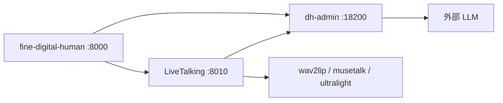

# digitalhuaman（LiveTalking-Muse 实验工具包）

[English](./README-EN.md)

See full Chinese documentation in this file; key facts:

- **Repo:** [digitalhuaman](https://github.com/IVMYM/digitalhuaman) — experimental fork/extensions on [LiveTalking](https://github.com/lipku/LiveTalking)
- **Licenses:** [LICENSE](./LICENSE) (Apache-2.0 for LiveTalking-origin files), [THIRD_PARTY_LICENSES.md](./THIRD_PARTY_LICENSES.md) (Wav2Lip non-commercial, MuseTalk MIT, etc.)
- **Scope:** [docs/PUBLICATION_SCOPE.md](./docs/PUBLICATION_SCOPE.md)

完整中文说明见下文。

---

面向 **实验与二次开发** 的数字人工具链：在 LiveTalking 上增加 `dh-admin` 管理台、`fine-digital-human` 整合页，以及 Colab/DSW/TURN 辅助脚本。

> **不保证**开箱即用的端到端 WebRTC 数字人通话。区分：**代码支持**、**历史观察（2026-11-03/04 Colab，未在本发布重测）**、**未验证**。

## 与上游差异

| 维度 | 上游 | 本仓库 |
|------|------|--------|
| LLM | 直连云 API | 支持 `llm_provider: dh-admin` |
| 前台 | web/ 内置 | + `fine-digital-human/` |
| 运维 | 较少 | `scripts/`（可选） |
| 模型 | 自备 | **未捆绑**权重，见 [docs/ASSETS_AND_MODELS.md](./docs/ASSETS_AND_MODELS.md) |

上游 README 副本：[docs/README-UPSTREAM-LIVETALKING-zh.md](./docs/README-UPSTREAM-LIVETALKING-zh.md)

## 架构（代码连线）



HTTP 隧道可转发信令；WebRTC **媒体**常需 STUN/TURN（见 [docs/ASSETS_AND_MODELS.md](./docs/ASSETS_AND_MODELS.md)）。

## 目录

| 路径 | 作用 |
|------|------|
| `app.py`, `server/`, `avatars/` | LiveTalking 核心 |
| `fine-digital-human/` | 浏览器业务页 + API 代理 |
| `dh-admin/` | 管理台 |
| `scripts/` | GPU/Colab 脚本说明见 [scripts/README.md](./scripts/README.md) |

## 环境与依赖

- **GPU + CUDA** 推理（代码无 CPU 保证）
- Python 3.10+；`dh-admin/frontend` 构建需 Node
- 自装 PyTorch；慎盲目重装 CUDA 轮子
- `websockets==12.0` 可能与 Colab 预装冲突（历史观察）

## 最小复现

**A. 无 GPU — dh-admin 测试（本发布可执行）：**

```bash
cd dh-admin/backend && python3 -m venv .venv && source .venv/bin/activate
pip install -r requirements.txt -r requirements-dev.txt && pytest -q
```

**B. 全链路（需 GPU + 下载模型，未在你环境验证）：**

1. 准备 `data/avatars/wav2lip256_avatar1/` 与权重（[docs/ASSETS_AND_MODELS.md](./docs/ASSETS_AND_MODELS.md)）
2. `python app.py --config config.yaml`
3. `uvicorn app.main:app --host 127.0.0.1 --port 18200`（`dh-admin/backend`，配置 `dh-admin/.env`）
4. `uvicorn app:app --host 127.0.0.1 --port 8000`（`fine-digital-human`，`DH_ADMIN_RUNTIME_TOKEN` 与 dh-admin 一致）

`.env` 模板：根目录、`dh-admin/`、`fine-digital-human/` 的 `.env.example`。

## 配置摘要

- [config.yaml](./config.yaml)：`avatar_id: wav2lip256_avatar1`，`max_session: 5`，TTS 示例 `zh-CN-YunxiaNeural`
- TURN：`.secrets/turn.env`（gitignore）

## 故障排查

| 现象 | 说明 |
|------|------|
| SDP 成功但黑屏 | ICE/媒体；配置 TURN |
| 5/5 会话 | `max_session` |
| Cloudflare/Colab | 不替代媒体路径 |

## 历史观察（非本次复测）

- Colab：torch 2.9.1+cu128，T4，CUDA True — **仅 GPU 检测**
- UI HTTP 200/302；trycloudflare 上 WebRTC 约 40s 黑屏，`connectionState` 未到 `connected`
- TURN **无**成功记录；`/sessionlist` **未确认** API

## 限制

- 无 vendor wasm（`fine-digital-human/static/vendor/`）、无权重
- Wav2Lip：**非商用** — [THIRD_PARTY_LICENSES.md](./THIRD_PARTY_LICENSES.md)
- 脚本中的人设代号（`zhengxin` 等）请改为你自己的 `avatar_id`

## 贡献

Fork → PR；勿提交密钥与权重；标明验证步骤。
